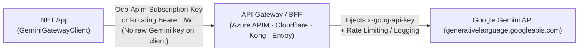

# GeminiGatewayClient

[](https://www.nuget.org/packages/GeminiGatewayClient)
[](https://github.com/Osg-Junue/GeminiGatewayClient/actions/workflows/ci.yml)
[](https://dotnet.microsoft.com/)
[](#)
[](LICENSE.txt)

**Call the Google Gemini API safely through Azure APIM, Cloudflare AI Gateway, Kong, Envoy, or internal BFFs in .NET.**

Custom auth headers · Per-request rotating tokens · Zero `DefaultRequestHeaders` pollution · `Microsoft.Extensions.AI` (`IChatClient`) & DI · 100% NativeAOT

📖 **[Usage Guide & Recipes](docs/USAGE.md)** · 📊 **[Gemini API Compatibility Matrix](docs/API_COMPATIBILITY.md)** · 📝 **[Changelog](CHANGELOG.md)**

---

## Why This Exists

- **The Problem:** Google's official `Google.GenAI` SDK assumes your app talks directly to `googleapis.com` with a static `x-goog-api-key` header. In production, you rarely distribute raw Gemini API keys to application nodes—traffic goes through an **API gateway, reverse proxy, or BFF** where clients authenticate using `Ocp-Apim-Subscription-Key`, `cf-aig-authorization`, or short-lived `Authorization: Bearer <jwt>` tokens.
- **The Solution:** `GeminiGatewayClient` is designed from the ground up for gateway-mediated architectures, clean `IHttpClientFactory` lifecycle management, `Microsoft.Extensions.AI` (`IChatClient`), and NativeAOT.



### `GeminiGatewayClient` vs. Official `Google.GenAI`

| Capability | `GeminiGatewayClient` | Official `Google.GenAI` |
|---|---|---|
| **Replace `x-goog-api-key` header** (`Ocp-Apim-Subscription-Key`, `Authorization`) | ✅ Built-in (`ApiKeyHeader` + `ApiKeyPrefix`) | ⚠️ Manual `HttpOptions` wiring |
| **Rotate short-lived OAuth / JWT tokens per request** | ✅ Built-in (`ApiKeyProvider` async callback) | ❌ Custom handler required |
| **Keyless client when gateway injects key upstream** (`ApiKey = null`) | ✅ Built-in | ⚠️ Custom auth workaround |
| **Zero `HttpClient.DefaultRequestHeaders` mutation** (per-request header isolation) | ✅ Guaranteed | ⚠️ Mutates shared client defaults |
| **Cross-host redirect credential leak protection** (`AllowAutoRedirect = false`) | ✅ Built-in | ❌ Manual handler required |
| **`IHttpClientFactory` + `IOptions<T>` DI** (`services.AddGeminiClient()`) | ✅ Built-in (`IHttpClientBuilder`) | ❌ Manual registration |
| **`Microsoft.Extensions.AI` (`IChatClient`) + persisted `thoughtSignature` recovery** | ✅ Built-in (`AsIChatClient()` / DI) | ⚠️ Requires raw part retention |
| **100% NativeAOT & Trim-Safe** (`<IsAotCompatible>true</IsAotCompatible>`) | ✅ Zero reflection (`GeminiJsonContext`) | ⚠️ Partial reflection paths |
| **Per-chunk stream idle watchdog** (`StreamIdleTimeout`) | ✅ Built-in (default 2 min) | ❌ Manual cancellation |

---

## Quick Start

```bash
dotnet add package GeminiGatewayClient
```

```csharp
using GeminiGatewayClient;
using Microsoft.Extensions.AI;
using Microsoft.Extensions.DependencyInjection;

var services = new ServiceCollection();

// Register IGeminiClient, GeminiClient, and Microsoft.Extensions.AI.IChatClient:
services.AddGeminiClient(options =>
{
    options.Endpoint = new Uri("https://contoso.azure-api.net/gemini/v1beta");
    options.Model = "gemini-3-flash-preview";
    options.ApiKey = builder.Configuration["Gemini:SubscriptionKey"];
    options.ApiKeyHeader = "Ocp-Apim-Subscription-Key"; // Sends only this header; x-goog-api-key is omitted
});

await using var provider = services.BuildServiceProvider();
var chatClient = provider.GetRequiredService<IChatClient>();

await foreach (var update in chatClient.GetStreamingResponseAsync("Explain NativeAOT in 3 bullet points."))
{
    Console.Write(update.Text);
}
```

Or use `GeminiClient` directly without DI:

```csharp
using GeminiGatewayClient;

using var client = new GeminiClient(
    apiKey: Environment.GetEnvironmentVariable("GEMINI_API_KEY")!,
    model: "gemini-3-flash-preview");

var response = await client.GenerateContentAsync("Explain quantum computing in three sentences.");
Console.WriteLine(response.Text);
```

---

## 3 Common Enterprise Gateway Patterns

### 1. Azure API Management (APIM Injects `x-goog-api-key` Upstream)

```csharp
var options = new GeminiClientOptions
{
    Endpoint = new Uri("https://contoso.azure-api.net/gemini/v1beta"),
    Model = "gemini-3-flash-preview",
    ApiKey = "<apim-subscription-key>",
    ApiKeyHeader = "Ocp-Apim-Subscription-Key"
};
```

### 2. Kong / Envoy / Internal BFF with Rotating Short-Lived Bearer JWT

```csharp
var options = new GeminiClientOptions
{
    Endpoint = new Uri("https://llm-gateway.internal/gemini/v1beta"),
    Model = "gemini-3-flash-preview",
    ApiKeyHeader = "Authorization",
    ApiKeyPrefix = "Bearer ",
    // Invoked before each HTTP request so short-lived Entra ID / OAuth tokens rotate cleanly:
    ApiKeyProvider = async ct => await tokenProvider.GetAccessTokenAsync(ct)
};
```

### 3. Cloudflare AI Gateway (Authenticated Gateway + Upstream Key or BYOK)

```csharp
var options = new GeminiClientOptions
{
    Endpoint = new Uri("https://gateway.ai.cloudflare.com/v1/<account-id>/<gateway-name>/google-ai-studio/v1beta"),
    Model = "gemini-3-flash-preview",
    ApiKey = "<gemini-api-key>", // Or set to null if Cloudflare injects the key via BYOK / Unified Billing
    AdditionalHeaders = new Dictionary<string, string>
    {
        ["cf-aig-authorization"] = "Bearer <cloudflare-gateway-token>"
    }
};
```

---

## Production-Verified Capabilities

Every feature is verified against both deterministic unit tests ([`tests/GeminiGatewayClient.Tests`](tests/GeminiGatewayClient.Tests)) and live end-to-end Gemini API scenarios ([`tests/GeminiGatewayClient.ExploratoryTests`](tests/GeminiGatewayClient.ExploratoryTests)):

- **Real-Time Streaming**: SSE (`?alt=sse`) and JSON-array streaming with `ArrayPool<byte>` buffering, split `\r\n` handling, in-stream HTTP 200 `{"error": ...}` detection, and `StreamIdleTimeout` watchdog.
- **Automatic & Parallel Tool Calling**: Multi-step `IChatClient` tool chains via `.UseFunctionInvocation()`, plus native parallel function calling and forced tool execution (`FunctionCallingMode.Any`).
- **Gemini 3 & 2.5 Thinking / Reasoning**: Supports `ThinkingLevel` (`Minimal`, `Low`, `Medium`, `High`), `ThinkingBudget`, `IncludeThoughts`, and model-aware `ChatOptions.Reasoning.Effort` mapping.
- **Lossless Chat History Persistence**: Round-trips Gemini 3 `thoughtSignature` and synthesized tool call IDs through `AdditionalProperties` (`GeminiChatPropertyNames`) even when `RawRepresentation` is stripped by database/JSON serialization.
- **Structured Output & Multimodal**: `ResponseJsonSchema` (`JsonElement`), OpenAPI `Schema`, inline binary `Blob` (`Part.FromBytes`), and `FileData` (`Part.FromUri`).
- **Spec-Change Resilience**: All 27 DTOs include `[JsonExtensionData]` and all 14 wire enums use a zero-allocation `LenientStringEnumConverter<T>` with `Unknown` fallback.

---

## Documentation

- 📘 **[Usage Guide & Recipes (`docs/USAGE.md`)](docs/USAGE.md)** — Full code examples for DI & resilience handlers, streaming, structured JSON output, thinking/reasoning, multimodal inputs, `IChatClient` tool chains, database chat persistence, and `GeminiClientOptions`.
- 📊 **[Gemini API Compatibility Matrix (`docs/API_COMPATIBILITY.md`)](docs/API_COMPATIBILITY.md)** — Complete field-by-field mapping against the official Google Gemini REST API specification and `Microsoft.Extensions.AI`.
- 📝 **[Changelog (`CHANGELOG.md`)](CHANGELOG.md)** — Release history and v2 migration notes.

---

## License & Resources

- Released under the [MIT License](LICENSE.txt).
- Issues and pull requests are welcome at [Osg-Junue/GeminiGatewayClient](https://github.com/Osg-Junue/GeminiGatewayClient).
