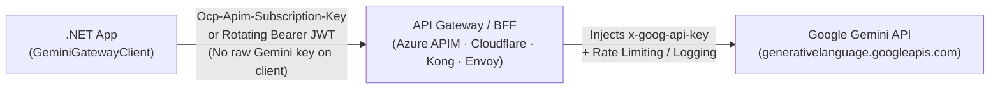

# GeminiGatewayClient

[](https://www.nuget.org/packages/GeminiGatewayClient)
[](https://github.com/Osg-Junue/GeminiGatewayClient/actions/workflows/ci.yml)
[](https://dotnet.microsoft.com/)
[](#)
[](LICENSE.txt)

**Call the Google Gemini API safely through Azure APIM, Cloudflare AI Gateway, Kong, Envoy, or internal BFFs in .NET.**

Custom auth headers · Per-request rotating tokens · Zero `DefaultRequestHeaders` pollution · `Microsoft.Extensions.AI` (`IChatClient` & `IEmbeddingGenerator`) & DI · NativeAOT/Trim-aware design

📖 **[Usage Guide & Recipes](docs/USAGE.md)** · 📊 **[Gemini API Compatibility Matrix](docs/API_COMPATIBILITY.md)** · 📝 **[Changelog](CHANGELOG.md)**

---

## Why This Exists

- **The Problem:** Google's official `Google.GenAI` SDK assumes your app talks directly to `googleapis.com` with a static `x-goog-api-key` header. In production, you rarely distribute raw Gemini API keys to application nodes—traffic goes through an **API gateway, reverse proxy, or BFF** where clients authenticate using `Ocp-Apim-Subscription-Key`, `cf-aig-authorization`, or short-lived `Authorization: Bearer <jwt>` tokens.
- **The Solution:** `GeminiGatewayClient` is designed for gateway-mediated architectures, clean `IHttpClientFactory` lifecycle management, `Microsoft.Extensions.AI` (`IChatClient` and `IEmbeddingGenerator<string, Embedding<float>>`), and NativeAOT-friendly publishing.



### `GeminiGatewayClient` vs. Official `Google.GenAI`

| Capability | `GeminiGatewayClient` | Official `Google.GenAI` |
|---|---|---|
| **Replace `x-goog-api-key` header** (`Ocp-Apim-Subscription-Key`, `Authorization`) | ✅ Built-in (`ApiKeyHeader` + `ApiKeyPrefix`) | ⚠️ Manual `HttpOptions` wiring |
| **Rotate short-lived OAuth / JWT tokens per call** | ✅ Built-in (`ApiKeyProvider` async callback) | ❌ Custom handler required |
| **Keyless client when gateway injects key upstream** (`ApiKey = null`) | ✅ Built-in | ⚠️ Custom auth workaround |
| **Accurate `CitationAnnotation` spans on `IChatClient`** (UTF-8 to UTF-16, including Japanese text) | ✅ Built-in | ❌ Read `RawRepresentation` yourself |
| **Cross-host redirect credential leak protection** (`AllowAutoRedirect = false`) | ✅ Built-in on clients the library creates; `GeminiClient.CreateDefaultHandler()` for your own `HttpClient` | ❌ Manual handler required |
| **`IHttpClientFactory` + `IOptions<T>` DI** (`services.AddGeminiClient()`) | ✅ Built-in (`IHttpClientBuilder`) | ❌ Manual registration |
| **`Microsoft.Extensions.AI` (`IChatClient` & `IEmbeddingGenerator`) + `thoughtSignature` recovery** | ✅ Built-in (`AsIChatClient()`, `AsIEmbeddingGenerator()` / DI) | ⚠️ Requires raw part retention |
| **Native AOT** (`dotnet publish -p:PublishAot=true`) | ✅ No warnings; CI runs a native smoke test | ⚠️ 9 IL warnings (version 1.28.0), so behavior is not guaranteed |
| **Stream idle timeout** (`StreamIdleTimeout`) | ✅ Built-in (default 2 min) | ❌ Only a total timeout, which also ends healthy slow streams |

---

## Quick Start

```bash
dotnet add package GeminiGatewayClient
```

```csharp
using GeminiGatewayClient;
using Microsoft.Extensions.AI;
using Microsoft.Extensions.DependencyInjection;

var services = new ServiceCollection();

// Register IGeminiClient, GeminiClient, IChatClient, and IEmbeddingGenerator<string, Embedding<float>>:
services.AddGeminiClient(options =>
{
    options.Endpoint = new Uri("https://contoso.azure-api.net/gemini/v1beta");
    options.Model = "gemini-flash-latest";
    options.EmbeddingModel = "gemini-embedding-001";
    options.ApiKey = Environment.GetEnvironmentVariable("GEMINI_SUBSCRIPTION_KEY");
    options.ApiKeyHeader = "Ocp-Apim-Subscription-Key"; // Sends only this header; x-goog-api-key is omitted
});

await using var provider = services.BuildServiceProvider();
var chatClient = provider.GetRequiredService<IChatClient>();

await foreach (var update in chatClient.GetStreamingResponseAsync("Explain NativeAOT in 3 bullet points."))
{
    Console.Write(update.Text);
}
```

Or use `GeminiClient` directly without DI:

```csharp
using GeminiGatewayClient;

using var client = new GeminiClient(
    apiKey: Environment.GetEnvironmentVariable("GEMINI_API_KEY")!,
    model: "gemini-flash-latest");

var response = await client.GenerateContentAsync("Explain quantum computing in three sentences.");
Console.WriteLine(response.Text);
```

---

## 3 Common Enterprise Gateway Patterns

### 1. Azure API Management (APIM Injects `x-goog-api-key` Upstream)

```csharp
var options = new GeminiClientOptions
{
    Endpoint = new Uri("https://contoso.azure-api.net/gemini/v1beta"),
    Model = "gemini-flash-latest",
    ApiKey = "<apim-subscription-key>",
    ApiKeyHeader = "Ocp-Apim-Subscription-Key"
};
```

### 2. Kong / Envoy / Internal BFF with Rotating Short-Lived Bearer JWT

```csharp
var options = new GeminiClientOptions
{
    Endpoint = new Uri("https://llm-gateway.internal/gemini/v1beta"),
    Model = "gemini-flash-latest",
    ApiKeyHeader = "Authorization",
    ApiKeyPrefix = "Bearer ",
    // Invoked once per client call, so short-lived Entra ID / OAuth tokens rotate cleanly (HTTP handler retries resend the same value):
    ApiKeyProvider = async ct => await tokenProvider.GetAccessTokenAsync(ct)
};
```

### 3. Cloudflare AI Gateway (Authenticated Gateway + Upstream Key or BYOK)

```csharp
var options = new GeminiClientOptions
{
    Endpoint = new Uri("https://gateway.ai.cloudflare.com/v1/<account-id>/<gateway-name>/google-ai-studio/v1beta"),
    Model = "gemini-flash-latest",
    ApiKey = "<gemini-api-key>", // Or set to null if Cloudflare injects the key via BYOK / Unified Billing
    AdditionalHeaders = new Dictionary<string, string>
    {
        ["cf-aig-authorization"] = "Bearer <cloudflare-gateway-token>"
    }
};
```

---

## Implemented Capabilities

Core behavior is covered by deterministic unit tests ([`tests/GeminiGatewayClient.Tests`](tests/GeminiGatewayClient.Tests)); live end-to-end scenarios are additionally covered by exploratory tests when API credentials are configured ([`tests/GeminiGatewayClient.ExploratoryTests`](tests/GeminiGatewayClient.ExploratoryTests)):

- **Real-Time Streaming**: Server-Sent Events (`?alt=sse`) read with `System.Net.ServerSentEvents`, the JSON array Gemini sends when a gateway does not forward `alt=sse` or `UseServerSentEvents` is `false`, error payloads sent with HTTP 200, and `StreamIdleTimeout`.
- **Automatic & Parallel Tool Calling**: Multi-step `IChatClient` tool chains via `.UseFunctionInvocation()`, plus native parallel function calling and forced tool execution (`FunctionCallingMode.Any`).
- **Google Search & URL Context Grounding**: Full typed response models (`GroundingMetadata`, `GroundingChunk`, `GroundingSupport`, `UrlContextMetadata`, `UrlRetrievalStatus`) and automatic `IChatClient` mapping to `CitationAnnotation` (converting Gemini UTF-8 byte offsets into UTF-16 `char` spans on `TextSpanAnnotatedRegion`) and `AdditionalProperties[GeminiChatPropertyNames.WebSearchQueries]`.
- **Embeddings & `IEmbeddingGenerator<string, Embedding<float>>`**: `EmbedContentAsync`, `BatchEmbedContentsAsync`, `AsIEmbeddingGenerator()` (always one `:batchEmbedContents` call, so the API's limit of 100 inputs applies), and `GeminiClientOptions.EmbeddingModel`.
- **Gemini 3 & 2.5 Thinking**: Set `ThinkingConfig` (`ThinkingLevel`, `ThinkingBudget`, `IncludeThoughts`) yourself; through `IChatClient`, use `ChatOptions.RawRepresentationFactory`.
- **Chat History Persistence**: Round-trips Gemini 3 `thoughtSignature` and synthesized tool call IDs through `AdditionalProperties` (`GeminiChatPropertyNames`) even when `RawRepresentation` is stripped by database/JSON serialization. Part kinds with no chat mapping need `RawRepresentation` to survive.
- **Structured Output & Multimodal**: `ResponseJsonSchema` (`JsonElement`), OpenAPI `Schema`, inline binary `Blob` (`Part.FromBytes`), and `FileData` (`Part.FromUri`).
- **Spec-Change Resilience**: All DTOs include `[JsonExtensionData]` and all 16 wire enums use a `LenientStringEnumConverter<T>` with `Unknown` fallback.

---

## Operational & Compatibility Notes

### Failure Modes & Exception Boundaries

| Failure Scenario | Exception Thrown | Operational Guidance |
|---|---|---|
| **Non-2xx HTTP status** or **in-stream `{"error": ...}`** after HTTP 200 | `GeminiApiException` | Check `ex.StatusCode` and `ex.ErrorStatus`, and honor `ex.RetryAfter` when present. Whether to retry is your decision. An invalid request reaches the API and comes back here as HTTP 400. |
| **Stalled stream** (no bytes received within `StreamIdleTimeout`, default **2 min**; keep-alive comments from a gateway count as data) | `TimeoutException` | An upstream proxy or connection hung mid-stream after the headers arrived. |
| **Request timeout** (`HttpClient.Timeout`, default **5 min** on clients the library creates, covering a complete response or the headers of a stream) or **caller cancellation** | `OperationCanceledException` (`TaskCanceledException`) | Distinguish caller cancellation (`ct.IsCancellationRequested`) from `HttpClient.Timeout` expiration (`!ct.IsCancellationRequested`). |
| **Connection lost** before the response, or while reading a successful response body or stream | `HttpRequestException` (`HttpRequestError` gives the failure category when known; `StatusCode` is set when a stream loses its connection) | Safe to retry only if your request is idempotent and any partial stream output is discarded. Resilience handlers do not see failures after the headers because streaming bodies are read outside the handler pipeline. |
| **Unusable configuration** | `ArgumentException` / `InvalidOperationException` | A header that cannot be sent fails when the client is created, and a missing model fails when the call is made. Requests themselves are not checked. |

### Production Deployment Checklist

- **Resilience Handler Timeouts**: `Microsoft.Extensions.Http.Resilience`'s `AddStandardResilienceHandler()` defaults to a **10-second** per-attempt timeout, which will prematurely cancel Gemini 2.5 / 3 thinking requests. Explicitly increase `AttemptTimeout`, `TotalRequestTimeout`, and `CircuitBreaker.SamplingDuration` (see [`docs/USAGE.md`](docs/USAGE.md#2-dependency-injection-ihttpclientfactory--resilience)).
- **Caller-Supplied `HttpClient`**: Passing a custom `HttpClient` to `new GeminiClient(options, httpClient)` does not overwrite `httpClient.Timeout` or handler redirect settings. Build it on `GeminiClient.CreateDefaultHandler()`, or set `SocketsHttpHandler.AllowAutoRedirect = false` and `UseCookies = false` yourself, to prevent credential headers from leaking on redirects and cookies from passing between callers (`services.AddGeminiClient()` configures this automatically).
- **API Scope & Vertex AI Compatibility**:
  - **In Scope**: Stateless generation, streaming, and embeddings (`:generateContent`, `:streamGenerateContent` via SSE, `:embedContent`, `:batchEmbedContents`, `tunedModels/{id}`, consuming `fileData.fileUri` and `cachedContent`).
  - **Out of Scope**: Stateful/management endpoints (`files` upload, `cachedContents` CRUD, `batches`, `countTokens`, and WebSocket `BidiGenerateContent` Live API).
  - **Vertex AI-Only Fields**: `GenerateContentRequest.Labels` and `GenerationConfig.AudioTimestamp` are supported for Vertex AI gateways (`aiplatform.googleapis.com`) and are rejected with HTTP 400 by Google AI Studio (`generativelanguage.googleapis.com`). See [`docs/API_COMPATIBILITY.md`](docs/API_COMPATIBILITY.md) for the full field matrix.

---

## Documentation

- 📘 **[Usage Guide & Recipes (`docs/USAGE.md`)](docs/USAGE.md)** — Full code examples for DI & resilience handlers, streaming, structured JSON output, thinking/reasoning, multimodal inputs, `IChatClient` tool chains, grounding citations, embeddings (`IEmbeddingGenerator`), database chat persistence, and `GeminiClientOptions`.
- 🧭 **[Architecture Diagrams (`docs/ARCHITECTURE.md`)](docs/ARCHITECTURE.md)** — Use cases, class structure, and sequence diagrams of the implementation.
- 📊 **[Gemini API Compatibility Matrix (`docs/API_COMPATIBILITY.md`)](docs/API_COMPATIBILITY.md)** — Complete field-by-field mapping against the official Google Gemini REST API specification and `Microsoft.Extensions.AI`.
- 📝 **[Changelog (`CHANGELOG.md`)](CHANGELOG.md)** — Release history.

---

## License & Resources

- Released under the [MIT License](LICENSE.txt).
- Issues and pull requests are welcome at [Osg-Junue/GeminiGatewayClient](https://github.com/Osg-Junue/GeminiGatewayClient).
