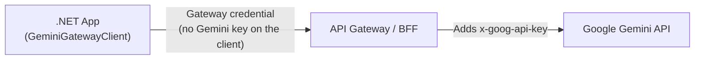

# GeminiGatewayClient

[](https://www.nuget.org/packages/GeminiGatewayClient)
[](https://github.com/Osg-Junue/GeminiGatewayClient/actions/workflows/ci.yml)
[](https://dotnet.microsoft.com/)
[](https://github.com/Osg-Junue/GeminiGatewayClient/blob/master/docs/usage/native-aot.md)
[](https://github.com/Osg-Junue/GeminiGatewayClient/blob/master/LICENSE.txt)

**A small .NET client for the Google Gemini API, built to run behind API gateways.**

Send your gateway's own credential instead of a Gemini key, rotate tokens per call, and use `Microsoft.Extensions.AI`, `IHttpClientFactory`, and Native AOT.

📖 **[Usage Guide](https://github.com/Osg-Junue/GeminiGatewayClient/blob/master/docs/usage/README.md)** · 🧯 **[Errors and Exceptions](https://github.com/Osg-Junue/GeminiGatewayClient/blob/master/docs/usage/errors.md)** · 📊 **[API Compatibility](https://github.com/Osg-Junue/GeminiGatewayClient/blob/master/docs/API_COMPATIBILITY.md)** · 📝 **[Changelog](https://github.com/Osg-Junue/GeminiGatewayClient/blob/master/CHANGELOG.md)**

## Why This Exists

In production, a Gemini key often stays out of the application. Traffic goes through an API gateway or BFF, and the application authenticates with `Ocp-Apim-Subscription-Key`, `cf-aig-authorization`, or a short-lived bearer token.



This library treats that as the normal case: which header carries the credential, whether there is one at all, and where the request goes are all options.

It stays small on purpose. It covers generation and embeddings, and it leaves input validation, retries, and model knowledge to you. See [What the Library Leaves to You](https://github.com/Osg-Junue/GeminiGatewayClient/blob/master/docs/usage/getting-started.md#what-the-library-leaves-to-you).

## Quick Start

```bash
dotnet add package GeminiGatewayClient
```

Directly against Gemini:

```csharp
using GeminiGatewayClient;

using var client = new GeminiClient(
    apiKey: Environment.GetEnvironmentVariable("GEMINI_API_KEY")!,
    model: "gemini-flash-latest");

var response = await client.GenerateContentAsync("Explain quantum computing in three sentences.");
Console.WriteLine(response.Text);
```

Behind a gateway, with dependency injection and `IChatClient`:

```csharp
using GeminiGatewayClient;
using Microsoft.Extensions.AI;
using Microsoft.Extensions.DependencyInjection;

var services = new ServiceCollection();

services.AddGeminiClient(options =>
{
    options.Endpoint = new Uri("https://contoso.azure-api.net/gemini/v1beta");
    options.Model = "gemini-flash-latest";
    options.ApiKey = Environment.GetEnvironmentVariable("GATEWAY_KEY");
    options.ApiKeyHeader = "Ocp-Apim-Subscription-Key"; // Sent instead of x-goog-api-key
});

await using var provider = services.BuildServiceProvider();
var chatClient = provider.GetRequiredService<IChatClient>();

await foreach (var update in chatClient.GetStreamingResponseAsync("Explain Native AOT in three bullet points."))
{
    Console.Write(update.Text);
}
```

Short-lived tokens are fetched once per client call:

```csharp
var options = new GeminiClientOptions
{
    Endpoint = new Uri("https://llm-proxy.internal/gemini/v1beta"),
    Model = "gemini-flash-latest",
    ApiKeyHeader = "Authorization",
    ApiKeyPrefix = "Bearer ",
    ApiKeyProvider = async ct => await tokenProvider.GetAccessTokenAsync(ct)
};
```

More gateways, including Cloudflare AI Gateway and keyless setups, are in [Configuration](https://github.com/Osg-Junue/GeminiGatewayClient/blob/master/docs/usage/configuration.md#credentials-and-gateways).

## Features

| Area | What you get | Guide |
|---|---|---|
| **Connection** | Custom endpoint, credential header, prefix, and extra headers; rotating credentials; no credential at all | [Configuration](https://github.com/Osg-Junue/GeminiGatewayClient/blob/master/docs/usage/configuration.md) |
| **Safety on the wire** | No redirects or cookies by default, so credentials stay on the intended host; `http://` refused for remote hosts; options that hide secrets in logs | [Configuration](https://github.com/Osg-Junue/GeminiGatewayClient/blob/master/docs/usage/configuration.md#using-your-own-httpclient) |
| **Generation** | `:generateContent`, system instructions, safety settings, multi-turn history | [Text Generation](https://github.com/Osg-Junue/GeminiGatewayClient/blob/master/docs/usage/text-generation.md) |
| **Streaming** | Server-Sent Events or the JSON array format, errors sent with HTTP 200, and an idle timeout | [Text Generation](https://github.com/Osg-Junue/GeminiGatewayClient/blob/master/docs/usage/text-generation.md#streaming) |
| **Structured output** | JSON Schema, typed `Schema`, enums | [Structured Output](https://github.com/Osg-Junue/GeminiGatewayClient/blob/master/docs/usage/structured-output.md) |
| **Thinking** | `ThinkingConfig` and `ChatOptions.Reasoning`, with signatures preserved | [Thinking](https://github.com/Osg-Junue/GeminiGatewayClient/blob/master/docs/usage/thinking.md) |
| **Multimodal** | Inline bytes, file URIs, video clipping | [Multimodal Input](https://github.com/Osg-Junue/GeminiGatewayClient/blob/master/docs/usage/multimodal.md) |
| **Function calling** | Full control with `GeminiClient`, or automatic with `UseFunctionInvocation()` | [Function Calling](https://github.com/Osg-Junue/GeminiGatewayClient/blob/master/docs/usage/function-calling.md) |
| **Built-in tools** | Google Search, URL Context, code execution, and `CitationAnnotation` spans converted to `string` indices | [Grounding](https://github.com/Osg-Junue/GeminiGatewayClient/blob/master/docs/usage/grounding.md) |
| **`Microsoft.Extensions.AI`** | `IChatClient` and `IEmbeddingGenerator`, with history that survives JSON serialization | [`IChatClient`](https://github.com/Osg-Junue/GeminiGatewayClient/blob/master/docs/usage/chat-client.md) |
| **Embeddings** | `:embedContent` and `:batchEmbedContents` | [Embeddings](https://github.com/Osg-Junue/GeminiGatewayClient/blob/master/docs/usage/embeddings.md) |
| **Native AOT** | No trim or AOT warnings; CI publishes and runs a native smoke test | [Native AOT](https://github.com/Osg-Junue/GeminiGatewayClient/blob/master/docs/usage/native-aot.md) |
| **API changes** | Unknown fields stay in `ExtensionData`, and unknown enum values read as `Unknown` | [Text Generation](https://github.com/Osg-Junue/GeminiGatewayClient/blob/master/docs/usage/text-generation.md#reading-a-response) |

## Compared with `Google.GenAI`

[`Google.GenAI`](https://github.com/googleapis/dotnet-genai) is Google's official SDK, and it does far more. **If you call Google directly, or need files, caching, batches, tuning, image or video generation, or the Live API, use it.** This library is for when the gateway is the main concern.

The table compares `GeminiGatewayClient` 4.1 with `Google.GenAI` 2.0.0, checked on 2026-11-06 from the package's public API and by running it against a local test server. The SDK changes quickly, so check it again before you decide.

| | `GeminiGatewayClient` | `Google.GenAI` 2.0.0 |
|---|---|---|
| **Target frameworks** | .NET 10 | .NET 8, .NET Standard 2.0 |
| **API coverage** | Generate, stream, embed | Also files, caches, batches, tunings, models, token counting, images, videos, Live |
| **`Microsoft.Extensions.AI`** | `IChatClient`, `IEmbeddingGenerator` | Also `IImageGenerator`, `IHostedFileClient`, `IRealtimeClient` |
| **Custom endpoint** | `Endpoint` | `HttpOptions.BaseUrl` |
| **Extra headers** | `AdditionalHeaders` | `HttpOptions.Headers`, also per call |
| **Replacing the credential header** | `ApiKeyHeader` and `ApiKeyPrefix` | With an API key, `x-goog-api-key` is always sent. Removing it takes a handler through `ClientOptions.HttpClientFactory` |
| **No key on the client** | Leave `ApiKey` unset | An API key is required. Needs a placeholder key and a handler that removes it |
| **Rotating tokens** | `ApiKeyProvider`, async, per call, in any header | `ICredential` per request, as `Authorization` in Vertex AI mode with its URL paths. With an API key, set per-call `HttpOptions.Headers` yourself |
| **Custom `HttpClient`** | Constructor argument | `ClientOptions.HttpClientFactory` |
| **Dependency injection** | `AddGeminiClient()` with `IHttpClientFactory` and options validation | No registration helper in the package |
| **Cross-host redirects** | Not followed by default | Followed, and `x-goog-api-key` went to the new host in our test. Your own handler can turn this off |
| **Retries** | None built in. Add a resilience handler | `HttpOptions.RetryOptions` |
| **Stalled streams** | `StreamIdleTimeout`, which resets on any data | No idle timeout. `HttpOptions.Timeout` also ended a healthy stream that ran longer than it |
| **Citations on `IChatClient`** | `CitationAnnotation` with spans | No annotations in our test. Read `RawRepresentation` |
| **`thoughtSignature` in JSON-serialized chat history** | Kept | Kept |
| **Native AOT** | No warnings; CI runs a native smoke test | A small sample published and started, with 7 warnings from dependencies (`Newtonsoft.Json`, `Google.Apis.Core`, `Microsoft.CSharp`, `System.Linq.Expressions`, `System.Management`) |

## Documentation

- 📖 **[Usage Guide](https://github.com/Osg-Junue/GeminiGatewayClient/blob/master/docs/usage/README.md)**: every topic, with samples
- 🧯 **[Errors and Exceptions](https://github.com/Osg-Junue/GeminiGatewayClient/blob/master/docs/usage/errors.md)**: every exception and failure case
- 📊 **[API Compatibility](https://github.com/Osg-Junue/GeminiGatewayClient/blob/master/docs/API_COMPATIBILITY.md)**: field-by-field mapping to the Gemini REST API
- 🧭 **[Architecture](https://github.com/Osg-Junue/GeminiGatewayClient/blob/master/docs/ARCHITECTURE.md)**: class structure and sequence diagrams (Japanese)
- 📝 **[Changelog](https://github.com/Osg-Junue/GeminiGatewayClient/blob/master/CHANGELOG.md)**

## License

Released under the [MIT License](https://github.com/Osg-Junue/GeminiGatewayClient/blob/master/LICENSE.txt). Issues and pull requests are welcome at [Osg-Junue/GeminiGatewayClient](https://github.com/Osg-Junue/GeminiGatewayClient).
