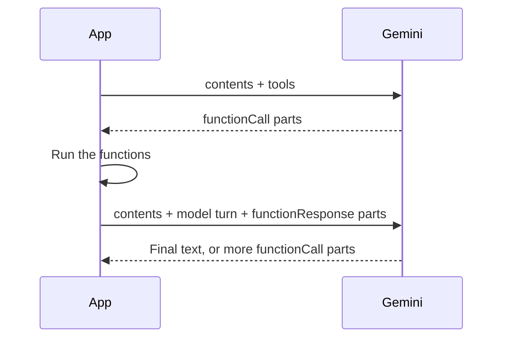

# Function Calling

The model does not run your code. It asks you to call a function, you run it, and you send the result back. Then the model continues, and may ask for more.



There are two ways to do this.

| | [`GeminiClient`](#building-function-calls-with-geminiclient) | [`IChatClient`](#automatic-function-calling-with-ichatclient) |
|---|---|---|
| **Declaration** | `FunctionDeclaration` and a schema you write | `AIFunctionFactory` reads your C# method |
| **Loop** | You run it | `UseFunctionInvocation()` runs it |
| **Choose it when** | You need control of each step, approval, or logging | The default loop fits |

## Building Function Calls with `GeminiClient`

### 1. Declare the Functions

A `FunctionDeclaration` tells the model what it can call. `Name` is required, and a clear `Description` is what the model uses to decide when to call it.

| Property | Purpose |
|---|---|
| `Name` | Function name |
| `Description` | What it does and when to use it |
| `ParametersJsonSchema` | Parameters as standard JSON Schema (`JsonElement`) |
| `Parameters` | Parameters as a typed `Schema`. Do not set it together with `ParametersJsonSchema` |
| `ResponseJsonSchema`, `Response` | Optional shape of the result |

**With JSON Schema**, which also allows keywords such as `$ref`:

```csharp
using System.Text.Json;
using GeminiGatewayClient.Models;

using var schema = JsonDocument.Parse("""
    {
      "type": "object",
      "properties": {
        "city": { "type": "string", "description": "City name in English" },
        "unit": { "type": "string", "enum": ["celsius", "fahrenheit"] }
      },
      "required": ["city"]
    }
    """);

var getWeather = new FunctionDeclaration
{
    Name = "get_weather",
    Description = "Gets the current weather for a city.",
    ParametersJsonSchema = schema.RootElement.Clone()
};
```

**With the typed `Schema`:**

```csharp
using GeminiGatewayClient.Models;

var getWeather = new FunctionDeclaration
{
    Name = "get_weather",
    Description = "Gets the current weather for a city.",
    Parameters = new Schema
    {
        Type = SchemaType.Object,
        Properties = new Dictionary<string, Schema>
        {
            ["city"] = new() { Type = SchemaType.String, Description = "City name in English" },
            ["unit"] = new() { Type = SchemaType.String, Enum = ["celsius", "fahrenheit"] }
        },
        Required = ["city"]
    }
};
```

**Without parameters**, leave both unset:

```csharp
using GeminiGatewayClient.Models;

var getTime = new FunctionDeclaration { Name = "get_current_time", Description = "Gets the current UTC time." };
```

### 2. Send Them in a `Tool`

One `Tool` holds all your declarations:

```csharp
using GeminiGatewayClient.Models;

var request = new GenerateContentRequest
{
    Contents = [Content.FromText("What is the weather in Sapporo?")],
    Tools = [new Tool { FunctionDeclarations = [getWeather] }]
};

var response = await client.GenerateContentAsync(request);
```

### 3. Control When Functions Are Called

`ToolConfig` is optional. Without it, the model decides.

| `FunctionCallingMode` | Behavior |
|---|---|
| `Auto` | The model chooses between a function call and text |
| `Any` | The model must call a function. `AllowedFunctionNames` can narrow the choice |
| `None` | The model does not call functions, even though they are declared |
| `Validated` | The model chooses, and function calls must follow the schema. `AllowedFunctionNames` also applies |

```csharp
using GeminiGatewayClient.Models;

var toolConfig = new ToolConfig
{
    FunctionCallingConfig = new FunctionCallingConfig
    {
        Mode = FunctionCallingMode.Any,
        AllowedFunctionNames = ["get_weather"]
    }
};
```

Set it on `GenerateContentRequest.ToolConfig`. With `Any`, the model keeps calling functions, so switch to `Auto` or `None` for the turn that should answer in text.

### 4. Read the Calls

`response.FunctionCalls` lists the calls in the first candidate, and is empty when there are none. The model can ask for several at once.

| `FunctionCall` | Value |
|---|---|
| `Name` | Function to run |
| `Args` | Arguments as a `JsonElement?`, `null` when there are none |
| `Id` | Call ID when the model sends one, otherwise `null` |

```csharp
foreach (var call in response.FunctionCalls)
{
    var city = call.Args?.GetProperty("city").GetString();
    Console.WriteLine($"{call.Name}({city})");
}
```

The model produces the arguments, so treat them as untrusted input. They may be missing or out of range, and validating them before acting is your code's job.

### 5. Build the Response

`Part.FromFunctionResponse` needs the function name and a JSON **object**. Pass the call's `Id` so the result pairs with its call. A number or string must be wrapped in an object, or it throws `ArgumentException`.

```csharp
using System.Text.Json;
using GeminiGatewayClient.Models;

var result = JsonSerializer.SerializeToElement(new Dictionary<string, object> { ["tempC"] = 12, ["sky"] = "Sunny" });
var part = Part.FromFunctionResponse("get_weather", result, id: "call-1");
```

To report a failure, send it as a normal result so the model can react:

```csharp
using System.Text.Json;
using GeminiGatewayClient.Models;

var failure = JsonSerializer.SerializeToElement(new Dictionary<string, string> { ["error"] = "Unknown city" });
var part = Part.FromFunctionResponse("get_weather", failure, id: "call-1");
```

Under Native AOT, serialize with source-generated metadata. See [Native AOT](native-aot.md).

### 6. Continue the Conversation

The next request must carry the history in this order:

1. The earlier contents.
2. The model's turn, unchanged. Use `TryGetModelContent`, which keeps the `thoughtSignature` that Gemini 3 models require on function calls.
3. One `user` content holding **all** the function responses of that turn.

### The Complete Loop

This runs until the model answers in text, with a limit so a model that keeps calling functions cannot loop forever:

```csharp
using System.Text.Json;
using GeminiGatewayClient;
using GeminiGatewayClient.Models;

using var schema = JsonDocument.Parse("""
    {
      "type": "object",
      "properties": { "city": { "type": "string" } },
      "required": ["city"]
    }
    """);

var tool = new Tool
{
    FunctionDeclarations =
    [
        new FunctionDeclaration
        {
            Name = "get_weather",
            Description = "Gets the current weather for a city.",
            ParametersJsonSchema = schema.RootElement.Clone()
        }
    ]
};

var contents = new List<Content>
{
    Content.FromText("Compare the weather in Sapporo and Fukuoka, and pick the sunnier city.")
};

const int maxRounds = 8;
string? answer = null;

for (var round = 0; round < maxRounds && answer is null; round++)
{
    var response = await client.GenerateContentAsync(new GenerateContentRequest
    {
        Contents = contents,
        Tools = [tool]
    });

    // A failed tool call is reported through the finish reason, with no exception.
    if (response.FinishReason is FinishReason.MalformedFunctionCall or FinishReason.UnexpectedToolCall or FinishReason.TooManyToolCalls)
    {
        throw new InvalidOperationException($"The model failed to call a tool: {response.FinishReason}");
    }

    // Add the model's turn first, with its parts unchanged.
    if (response.TryGetModelContent(out var modelContent))
    {
        contents.Add(modelContent);
    }

    if (response.FunctionCalls.Count == 0)
    {
        answer = response.Text ?? string.Empty;
        break;
    }

    // Answer every call of this turn in a single user content.
    var responseParts = new List<Part>(response.FunctionCalls.Count);
    foreach (var call in response.FunctionCalls)
    {
        responseParts.Add(Part.FromFunctionResponse(call.Name, Run(call), call.Id));
    }

    contents.Add(new Content { Role = Role.User, Parts = responseParts });
}

Console.WriteLine(answer ?? "No answer within the round limit.");

static JsonElement Run(FunctionCall call) => call.Name switch
{
    "get_weather" when call.Args?.TryGetProperty("city", out var city) == true =>
        JsonSerializer.SerializeToElement(new Dictionary<string, string> { ["city"] = city.GetString() ?? "", ["sky"] = "Sunny" }),
    _ => JsonSerializer.SerializeToElement(new Dictionary<string, string> { ["error"] = $"Cannot run {call.Name}" })
};
```

### Parallel Calls

The loop above already handles them. Several `functionCall` parts in one turn are all answered in one content, and the calls that do not depend on each other can run at the same time:

```csharp
using System.Text.Json;
using GeminiGatewayClient.Models;

var response = await client.GenerateContentAsync("Check Sapporo and Fukuoka.");

var parts = await Task.WhenAll(response.FunctionCalls.Select(async call =>
{
    JsonElement result = await RunAsync(call);
    return Part.FromFunctionResponse(call.Name, result, call.Id);
}));

var turn = new Content { Role = Role.User, Parts = parts };

static Task<JsonElement> RunAsync(FunctionCall call) =>
    Task.FromResult(JsonSerializer.SerializeToElement(new Dictionary<string, string> { ["sky"] = "Sunny" }));
```

### Function Calls in a Stream

Function calls arrive in chunks too. Collect the stream, then read them from the parts:

```csharp
using GeminiGatewayClient;
using GeminiGatewayClient.Models;

var request = new GenerateContentRequest
{
    Contents = [Content.FromText("What is the weather in Sapporo?")],
    Tools = [new Tool { FunctionDeclarations = [getWeather] }]
};

var modelContent = await client.StreamGenerateContentAsync(request).ToModelContentAsync();

var calls = modelContent?.Parts.Select(part => part.FunctionCall).OfType<FunctionCall>().ToList() ?? [];
```

Add `modelContent` to the history as in step 6.

### What Can Go Wrong

| Symptom | Cause | What to do |
|---|---|---|
| `FinishReason.MalformedFunctionCall` | The model produced an invalid call | Retry, or simplify the schema |
| `FinishReason.UnexpectedToolCall` | The model called a function that was not offered | Check the declared tools |
| `FinishReason.TooManyToolCalls` | Too many calls in a row | Reduce the work per request |
| `FinishReason.MissingThoughtSignature` | A signature did not come back | Resend the model's turn unchanged |
| HTTP 400 on the next request | The model's turn or a response was changed or left out | Follow step 6 |
| `ArgumentException` from `Part.FromFunctionResponse` | The result is not a JSON object | Wrap it in an object |

Treat a limit on rounds as required: the loop has no end of its own.

## Automatic Function Calling with `IChatClient`

`AIFunctionFactory` builds the declaration from a C# method, and `UseFunctionInvocation()` runs the loop:

```csharp
using System.ComponentModel;
using GeminiGatewayClient;
using Microsoft.Extensions.AI;

[Description("Gets the current weather for a city.")]
static string GetWeather([Description("City name in English")] string city) => $"{city}: Sunny, 12°C";

IChatClient pipeline = new ChatClientBuilder(client.AsIChatClient())
    .UseFunctionInvocation()
    .Build();

var options = new ChatOptions
{
    Tools = [AIFunctionFactory.Create(GetWeather, "get_weather")]
};

ChatResponse response = await pipeline.GetResponseAsync("What is the weather in Sapporo?", options);
Console.WriteLine(response.Text);
```

Streaming works the same way with `GetStreamingResponseAsync`.

`ChatOptions.ToolMode` maps to `ToolConfig`:

| `ChatToolMode` | `FunctionCallingMode` |
|---|---|
| `Auto` | `Auto` |
| `None` | `None` |
| `RequireAny` | `Any` |
| `RequireSpecific(name)` | `Any` with `AllowedFunctionNames = [name]` |

### Running the Loop Yourself

Without `UseFunctionInvocation()`, the response holds `FunctionCallContent` items. Answer them with `FunctionResultContent`, and keep the calls in the history:

```csharp
using Microsoft.Extensions.AI;

var tool = AIFunctionFactory.Create((string city) => $"{city}: Sunny", "get_weather");
var options = new ChatOptions { Tools = [tool] };
var history = new List<ChatMessage> { new(ChatRole.User, "What is the weather in Sapporo?") };

var response = await chatClient.GetResponseAsync(history, options);
history.AddRange(response.Messages);

var results = response.Messages
    .SelectMany(message => message.Contents)
    .OfType<FunctionCallContent>()
    .Select(call => new FunctionResultContent(call.CallId, "Sunny"))
    .ToList<AIContent>();

history.Add(new ChatMessage(ChatRole.Tool, results));
var final = await chatClient.GetResponseAsync(history, options);
```

Good to know:

- A `FunctionResultContent` needs its `FunctionCallContent` in the same messages, because only the call holds the function name. Without it, the call throws `ArgumentException`. When you trim a history, remove them together.
- When Gemini sends no call ID, a local one is made for `CallId`, marked with `GeminiChatPropertyNames.SynthesizedCallId`, and never sent back.
- A result that is not a JSON object is wrapped as `{"result": value}`.
- `MalformedFunctionCall`, `UnexpectedToolCall`, and `TooManyToolCalls` give a `FinishReason` of `null`, even next to function calls. The original value stays on `RawRepresentation`.
- Custom result types under Native AOT need `toolSerializerOptions`. See [Native AOT](native-aot.md).

## Combining with Built-in Tools

Gemini answers HTTP 400 when one request mixes functions with Google Search or code execution, unless it sets `toolConfig.includeServerSideToolInvocations`. Set that through `ExtensionData`:

```csharp
using System.Text.Json;
using GeminiGatewayClient.Models;

var toolConfig = new ToolConfig
{
    ExtensionData = new Dictionary<string, JsonElement>
    {
        ["includeServerSideToolInvocations"] = JsonDocument.Parse("true").RootElement
    }
};
```

With `IChatClient`, return that `ToolConfig` from `RawRepresentationFactory`, as a new request on each call:

```csharp
using System.Text.Json;
using GeminiGatewayClient.Models;
using Microsoft.Extensions.AI;

var options = new ChatOptions
{
    Tools = [AIFunctionFactory.Create((string city) => $"{city}: Sunny", "get_weather"), new HostedWebSearchTool()],
    RawRepresentationFactory = _ => new GenerateContentRequest
    {
        ToolConfig = new ToolConfig
        {
            ExtensionData = new Dictionary<string, JsonElement>
            {
                ["includeServerSideToolInvocations"] = JsonDocument.Parse("true").RootElement
            }
        }
    }
};
```
